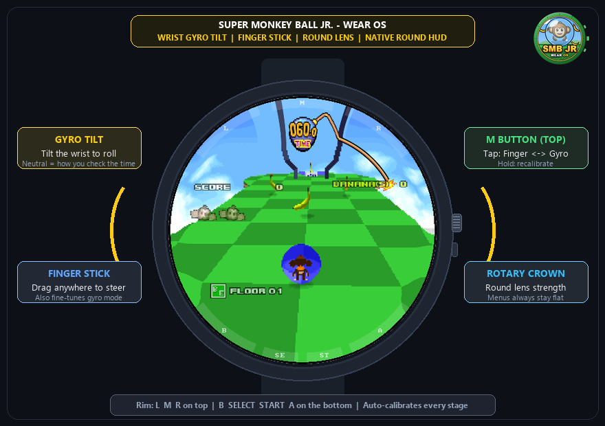

# Super Recomp Ball Jr. - Wear OS, Android, Desktop & Web Port

A native port of **Super Monkey Ball Jr.** (GBA, 2002, Realism/THQ) built for **Wear OS smartwatches** with round displays (Samsung Galaxy Watch 4/5/6/7/Ultra, Google Pixel Watch 1/2/3, Xiaomi Watch 2, etc.), plus Android phones, Windows/Linux/macOS and the web (WebAssembly). A custom **SDL3** shell adds wrist-gyro tilt, a round lens and a HUD redrawn for the round screen. The ROM is **not** distributed: each player loads their own copy.

> **Current phase: 2, static recompilation.** The game's code is translated to C ahead of time and runs as native code; mGBA only provides the GBA hardware. See [Project Phases](#-project-phases).

<p align="center">
  
</p>

---

## 🧭 Project Phases

### ✅ Phase 1: Native shell on the libmgba core
The game's ARM7TDMI code runs on the **libmgba** core (MPL-2.0), which interprets the CPU and emulates the GBA hardware. Everything around the core is new code written for this port:
- an SDL3 shell that runs on Wear OS, Android, desktop and the web from a single C code base;
- a HUD read from the GBA sprite memory (OAM/VRAM) every frame and redrawn natively for round and wide screens;
- the round lens, the flat-menu frame and the widescreen smart-stretch;
- a single input layer (finger, wrist/phone gyro, gamepad, keyboard) that turns analog tilt into fine D-pad pulses (sigma-delta PWM);
- ROM import with validation (QR/Wi-Fi on the watch, file picker on the phone, IndexedDB on the web) and EEPROM saves.

All four platforms are playable today.

### ✅ Phase 2: Real static recompilation
The game is no longer interpreted. Every instruction of Super Monkey Ball Jr. is translated **ahead of time** into C and compiled by each platform's own compiler (MinGW/GCC/Clang on desktop, the NDK on Wear OS and Android, Emscripten for the web), so the game runs as native x86-64, ARM64, ARMv7 or WebAssembly code.

**How it works**
- **`tools/recomp/recomp.py`** reads your ROM at build time and finds the code by recursive descent from the entry point, code pointers in literal pools and pointer tables, and the entry points learned at runtime (`entries.txt`). About 100,800 instructions are translated.
- Each contiguous block of code becomes one C function. Every guest instruction becomes straight-line C with its opcode fields as constants, branches inside a block become `goto`s, and calls/returns go through a small address dispatcher.
- The instruction semantics are mGBA's reference implementation (`isa-thumb.c` / `isa-arm.c`, MPL-2.0), turned into always-inline functions. The compiler folds the decoding away, and the recompiled code stays **cycle-exact** with the interpreter, so interrupts, timers and DMA happen at exactly the same instruction.
- **RAM code:** the 3D renderer is ARM code that the game unpacks (LZ77) into IWRAM, in several overlays that replace each other between scenes. Each overlay is recompiled from its LZ77 stream in the ROM, and a guard checks the live bytes before a block runs, so the matching overlay is always the one that executes. The boot-time copies to IWRAM and mGBA's HLE BIOS (the interrupt dispatcher) are recompiled the same way.
- The GBA hardware (video, sound, DMA, timers, interrupts, EEPROM) stays as a runtime library, the same split every console recompilation uses. In this phase that runtime is mGBA's hardware layer.

**How it is verified**
- **Coverage:** any address without native code falls back to the interpreter and is counted. `--misses FILE` writes them out, and `tools/recomp/learn.py` turns them into new entry points and RAM-code sources (`ramcode.txt`). Both files hold addresses only, never game bytes.
- **Equivalence:** `--hashlog FILE` writes a hash of the framebuffer + EWRAM + IWRAM after every frame. The same autoplay run with and without `--interp` must give identical files.
- Current result on the 3,600-frame autoplay (boot, menus, stage play): **100% native: 0 interpreted instructions, 0 guard misses, per-frame hashes identical to the interpreter.**

**Building it**
```bash
cmake -S . -B build/rc -G Ninja -DCMAKE_BUILD_TYPE=Release -DSMBJR_ROM="path/Super Monkey Ball Jr. (USA).gba"
cmake --build build/rc
./build/rc/smbjr rom.gba            # F10 switches between native code and the interpreter
```
Android/Wear OS builds pick the ROM up from `android/wear/dev-rom/` (or `-PsmbjrRom=path`); `-PnoRecomp` builds the interpreter-only shell. Without a ROM at build time you get the Phase 1 shell. The generated C is derived from the game, so it is **never committed or distributed**: you produce it from your own ROM. A build from another ROM revision detects the mismatch and uses the interpreter.

> ⚠️ A build made with `SMBJR_ROM` (APK, `.exe` or `.wasm`) contains code translated from the game. Keep it for yourself: do not upload it to a store, a release page or a public web host. The public web build is the interpreter-only shell, which asks each player for their own ROM.

### 🔭 Next phases
- **Phase 2b, leaner native code:** drop the per-instruction pipeline bookkeeping where it is provably unused, keep registers in locals across a block, and link known call targets directly instead of through the dispatcher.
- **Phase 3, native analog input:** patch the recompiled input routine so tilt reaches the game as a real analog value instead of D-pad pulses.
- **Phase 4, native renderer:** replace the game's software 3D rasterizer with a native one for high resolution, true widescreen and 60 fps.

---

## ⌚ What We Ported & Built for Wear OS

- **🤚 Wrist Gyro Tilt**: Roll the monkey by tilting your wrist, holding the watch the way you look at the time. The neutral pose is calibrated automatically at the start of every stage.
- **👆 Finger Stick**: Drag anywhere to steer; the anchor follows your thumb. In gyro mode the finger adds on top of the tilt for fine corrections.
- **🎮 One Simple `M` Button**: **Tap `M`** to switch **Finger ↔ Gyro**. **Hold `M`** to recalibrate the wrist's neutral pose ("Calibrado").
- **🔵 Round Lens In-Stage**: During play, the 3D stage fills the whole disc. The core around the ball is a plain, undistorted zoom, and only the outer band is compressed so the frame border meets the rim.
- **📄 Flat Menus**: Menus and 2D screens are never bent. The whole frame is the largest 3:2 picture that fits the glass, with full-size buttons in the free caps around it. The switch between the flat frame and the lens is animated and seamless.
- **📊 Native Round HUD**: HUD sprites are read from OAM each frame, the game's own sprite layer is hidden, and the HUD is redrawn for the round screen:
  - the timer bomb and fuse curve along the top rim;
  - SCORE / lives, BANANA(S) and FLOOR sit upright near the edge;
  - center messages (GO!, GOAL!) go through the same lens as the stage;
  - the result screens never overlap.
- **🎯 Rim Buttons**:
  - **In menus**, the buttons are full-size and placed around the picture: **`L` / `M` / `R`** on the top cap, and **`A` / `START` / `SELECT` / `B`** at the bottom.
  - **In-stage**, they shrink to a thin band on the rim at the same angles, so the center stays free for the swipe. They dim after 4 s without a touch.
- **⌚ Rotary Crown / Bezel**: Adjusts the lens strength (0 = whole flat frame in-stage too). The watch **back** button is `START` (pause).
- **🕹️ Analog → D-pad PWM (sigma-delta)**: A small tilt gives a small push, just like an analog stick.
- **📲 Wi-Fi ROM Transfer (QR Code)**: The watch shows a QR code: scan it with your phone and send your `.gba` over Wi-Fi. The ROM is validated (title `MONKEYBALLJR`, code `ALUE`), imported, and the upload copy is deleted right away.
- **🔒 Portrait Lock**: The game never rotates on the watch.
- **💾 Saves**: EEPROM (8 KB) persists in `smbjr.sav` in the app folder.

### Unified Controls on Every Platform
| Source | Details |
| :--- | :--- |
| Finger (swipe) | Anchor follows the thumb (gen1recomp-style trail stick) |
| Gyro / accelerometer | Watch, phone, web and **gamepads with motion sensors** (DualSense, Switch Pro…) |
| Gyro + finger | Both added together |
| Gamepad | Analog + D-pad + buttons (SDL3) |
| Keyboard | Arrows/WASD, Z = A, X = B, Enter = Start, Backspace = Select, Q/E = L/R |

---

## 🚀 How to Build & Install for Wear OS

### 0. Get the code
```bash
git clone --recursive https://github.com/gusdslara/super-recomp-ball-jr.git
# already cloned? git submodule update --init
```
mGBA 0.10.5 and SDL 3.4.10 are git submodules in `externals/`. The web build applies `patches/mgba-emscripten-no-pthreads.patch` to mGBA by itself.

### 1. Build the Wear OS APK
```bash
cd android
./gradlew :wear:assembleDebug
```
Output APK:
`android/wear/build/outputs/apk/debug/wear-debug.apk`

Use JDK 17/21 (for example, set `JAVA_HOME` to Android Studio's `jbr`). ABIs: armeabi-v7a (Galaxy Watch 4/5), arm64-v8a, x86_64 (emulator).

### 2. Install on your Smartwatch via ADB Wi-Fi
```bash
adb connect <WATCH_IP>:<PORT>
adb install -r android/wear/build/outputs/apk/debug/wear-debug.apk
```

### 3. ROM Setup
1. Open the app on the watch: it shows a **QR code** with the transfer address.
2. Scan it with a phone on the same Wi-Fi network and upload your `.gba`.
3. The watch validates the ROM, imports it into private storage and deletes the uploaded file.

The watch has to stay unlocked with the app on screen during the upload (Wear OS blocks the network for background apps).

**Developer shortcut:** debug builds bundle any `.gba` placed in `android/wear/dev-rom/` and import it on first launch. Build with `-PwearNoRom` to leave it out. `*.gba` files are git-ignored.

---

## 📱 Building for Android Phones / Tablets

```bash
cd android
./gradlew :app:assembleDebug
```
Output APK: `android/app/build/outputs/apk/debug/app-debug.apk`

On the phone, the app opens the system file picker for the ROM. Only Super Monkey Ball Jr. ROMs (any region) are accepted; another file is refused and the current ROM is kept. To switch ROMs later, long-press the app icon > **Trocar ROM**. In landscape it combines touch, a gyro that accounts for screen orientation, and Bluetooth/USB controllers. The touch overlay hides while a controller is in use.

Rectangular screens pick the layout by aspect ratio:
- up to about 1.6:1, the original **3:2** picture;
- up to 2.4:1 (21:9), **widescreen smart-stretch**, where the center stays 1:1 and only the sides stretch;
- beyond that (32:9), side bars.

The native HUD follows the real corners of the visible area.

---

## 🖥️ Desktop Build (Windows/MinGW, Linux, macOS)

```bash
cmake -S . -B build/desktop -G Ninja -DCMAKE_BUILD_TYPE=Release
cmake --build build/desktop
./build/desktop/smbjr "path/Super Monkey Ball Jr. (USA).gba"
./build/desktop/smbjr rom.gba --round --size 432x432   # simulates a round watch
./build/desktop/smbjr rom.gba --test 3600              # autoplay + screenshots in shots/
```
**Choosing the ROM:** started without a path, the window asks for the ROM: click it (or press Ctrl+O) to open the file dialog, or drag the `.gba` onto the window. The file is validated and copied to the user folder (`%APPDATA%/wearosports/smbjr/rom.gba` on Windows), so the next launch starts straight into the game. Ctrl+O swaps the ROM at any time.

**Options:**
- `--size WxH` (for example `2560x1080` ultrawide)
- `--touch` (shows the phone overlay)
- `--smooth`

**Shortcuts:**

| Key | Action |
| :--- | :--- |
| F1 | Control mode |
| F2 | Calibrate |
| F3 | Round: lens on/off; rectangular: 3:2 / widescreen / zoom |
| F4 | Overlay |
| F5 / F7 | Save / load state |
| F6 | Filter |
| F8 | PWM |
| F9 | Debug |
| Ctrl+O | Choose / swap ROM |
| Tab | Turbo |
| P | Pause |
| F11 | Fullscreen |

---

## 🌐 Web Build (WebAssembly)

```bash
# emsdk installed at C:/dev/tools/emsdk (or use emcmake)
cmake -S . -B build/web -G Ninja -DCMAKE_BUILD_TYPE=Release -DCMAKE_TOOLCHAIN_FILE=<emsdk>/upstream/emscripten/cmake/Modules/Platform/Emscripten.cmake
cmake --build build/web
python -m http.server 8090 --directory build/web    # open http://localhost:8090/smbjr.html
```
- **Hosting:** single-threaded (no SharedArrayBuffer/COOP-COEP), so it runs on any static host (GitHub Pages, Netlify…). About 1.5 MB of WASM.
- **Top bar:**
  - **Load ROM:** pick the `.gba` (or drag it onto the page). Only Super Monkey Ball Jr. is accepted; it is stored only in your browser's IndexedDB and loads by itself next time. Picking another file swaps it.
  - **Gyro:** asks for motion permission on iOS.
  - **Calibrate.**
  - **Fullscreen:** locks landscape on phones.
- **Saves:** EEPROM saves persist in IndexedDB.
- **Input:** touch, mouse, keyboard and the Gamepad API. The gyro comes from `devicemotion`, with screen-orientation correction.
- **Debug:** `?sw=1` switches to the software renderer and a timer loop, for automated canvas captures.

---

## 🗂️ Project Structure
```
src/main.c     SDL3 loop (callbacks), audio, hotkeys, --test mode
src/emu.c      libmgba wrapper (ROM, frame, blip audio, EEPROM, savestate)
src/input.c    touch/gyro/gamepad/keyboard -> analog -> D-pad PWM, calibration
src/view.c     round lens, flat menus, widescreen, native HUD, overlay, toasts
src/sprites.c  GBA sprite decoder (OAM/VRAM) -> RGBA HUD layers
src/hud.c      SMB Jr HUD groups, OAM detection
src/recomp/    static recompilation runtime: dispatcher, RAM-code guards, coverage, miss log
tools/recomp/  recomp.py (ARM/Thumb -> C), learn.py (runtime misses -> entries), entries.txt, ramcode.txt
web/shell.html web page (ROM, gyro, fullscreen, IndexedDB)
android/       :wear and :app + common/ (LauncherActivity, GameActivity, RomStore, RomInbox QR transfer)
externals/     mgba 0.10.5, SDL 3.4.10 (git submodules)
patches/       mGBA patch for the single-threaded web build
```

---

## 📜 Credits & Acknowledgments

- Original game by **Realism** and **THQ** (2002). Super Monkey Ball is a trademark of SEGA. Use only your own legally owned copy.
- Emulation core: [mGBA](https://github.com/mgba-emu/mgba) by endrift (MPL-2.0).
- Powered by [SDL3](https://github.com/libsdl-org/SDL) (zlib) and [ZXing](https://github.com/zxing/zxing) for the QR code (Apache-2.0).
- Trail-stick design inspired by [Gen1Recomp](https://github.com/bryanthaboi/gen1recomp).
- App icon: artwork supplied by the project owner (`android/icon-source.png`); `python android/make_icons.py` regenerates every Android, web and desktop size from it.
